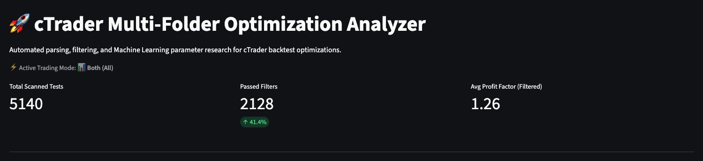
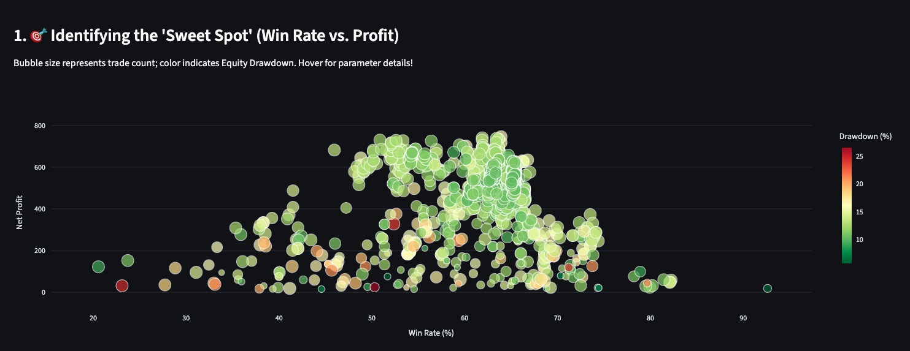
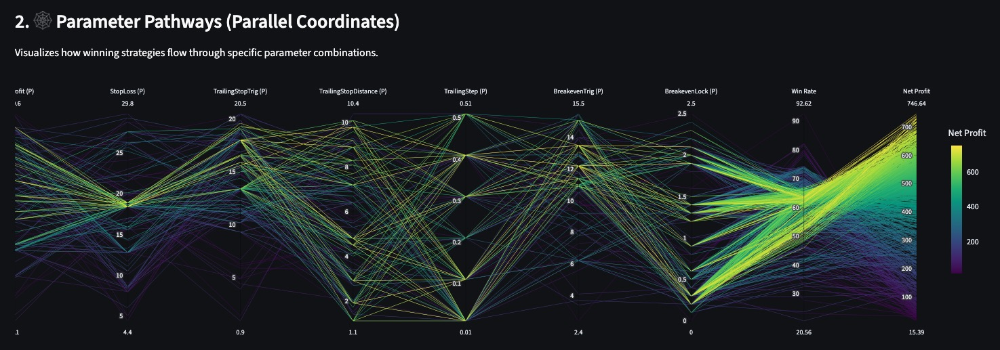
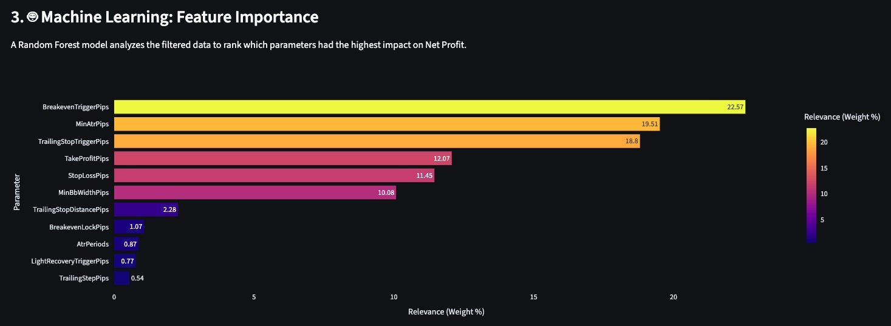
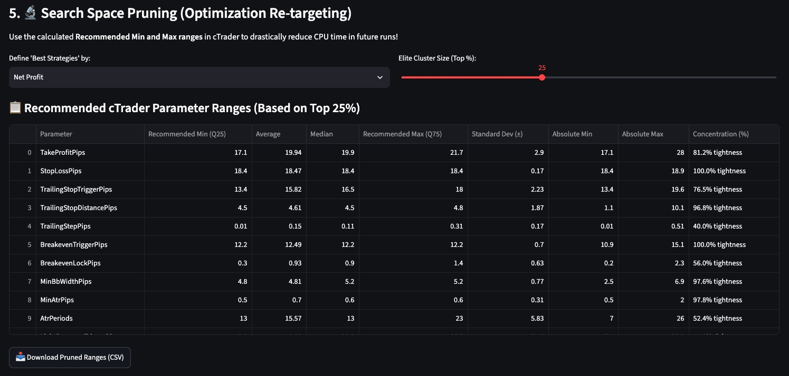
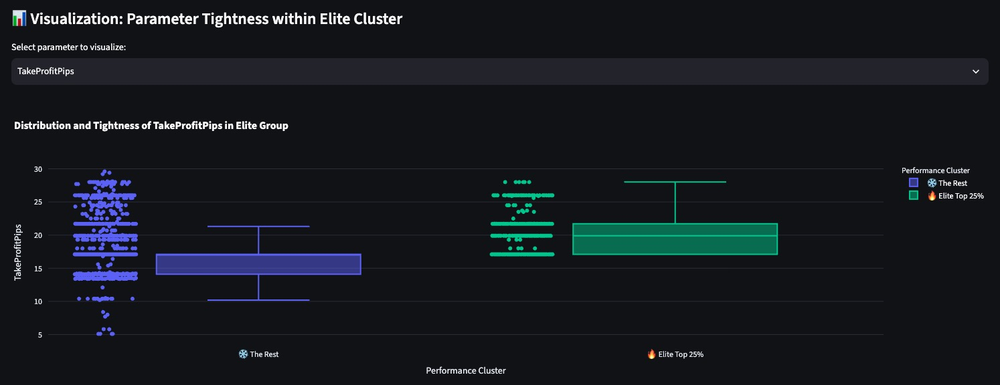
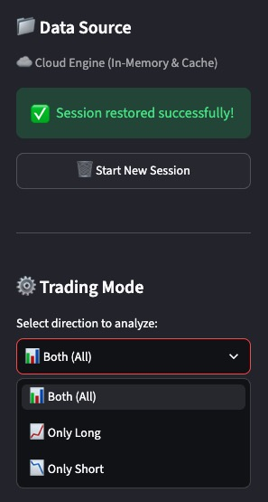
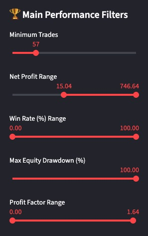
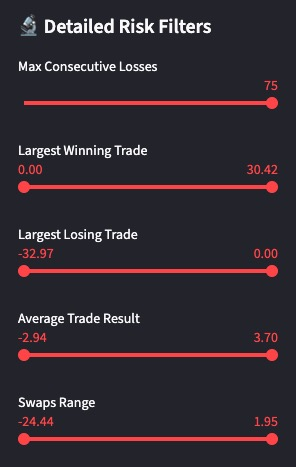

# 🚀 cTrader Multi-Folder Optimization Analyzer


[](https://donatr.ee/kulcsarbalazs)



A lightning-fast, highly optimized Python/Streamlit dashboard designed to parse, filter, and analyze massive cTrader algorithmic backtest optimizations. 

Built with a strict **"Data Engineering Pipeline"** mindset, this tool is designed to eliminate market noise, prevent curve-fitting, and drastically reduce your future CPU optimization time by pruning the parameter search space using Machine Learning.

---

## 🎯 Our Mission: The Right Tool for the Right Job

In algorithmic trading, especially when dealing with complex Pattern Signal indicator bots, there is a massive temptation to feed gigabytes of raw, multi-dimensional optimization data directly into an AI/LLM to "find the best settings." **This approach is deeply flawed.** It is computationally expensive, environmentally taxing, and highly susceptible to hallucinations caused by market noise.

This project implements a proper **Flow of Evaluation**:
1. **Heavy Lifting:** High-performance Python (Pandas) crunches gigabytes of raw `.cbotset` and `.html` reports in-memory, bypassing slow disk I/O.
2. **Noise Filtering:** Statistical anomalies and over-optimized passes are filtered out via strict risk metrics.
3. **ML Feature Importance:** A Random Forest algorithm objectively ranks which parameters actually drive profitability.
4. **Visual Distillation:** Millions of data points are compressed into lightweight, interactive Plotly charts.

*By the time the data reaches the final decision-making phase, the "noise" is gone, leaving you (or an AI agent) with pure, actionable trading intelligence.*

---

## ✨ Key Features & Usage Guide

This dashboard was specifically tested and built for complex cBots (like Pattern Signal Indicators) where parameter pathways are intricate.

### 1. Identifying the 'Sweet Spot'
The interactive bubble chart visualizes the classic **Win Rate vs. Net Profit** dilemma. Bubble size represents trade count, while color indicates Equity Drawdown. This helps you instantly spot clusters of robust, safe strategies rather than isolated, curve-fitted anomalies.



### 2. Parameter Pathways (Parallel Coordinates)
Trace the DNA of winning strategies. This chart visualizes how high-performing settings flow through specific parameter combinations (e.g., StopLoss, Trailing Step, Breakeven triggers).



### 3. Machine Learning: Feature Importance
Stop guessing which parameter matters. A built-in **Random Forest** model analyzes your filtered dataset and ranks the parameters by their actual impact on Net Profit.



### 4. Search Space Pruning (Optimization Re-targeting)
**The Ultimate Time Saver:** The analyzer isolates the top "Elite Cluster" (e.g., Top 25%) and calculates the exact statistical boundaries for each parameter. Use these exact `Min` and `Max` ranges in your next cTrader optimization run to reduce CPU time by up to 90%!




### 5. Deep Risk Filtering
Filter your raw data using strict institutional-grade metrics via the sidebar: Max Consecutive Losses, Largest Losing Trade, Minimum Trade Count, and Swap impacts, plus balance-curve stability filters (Trend R², Ulcer Index, Max Time Underwater) and position duration filters (bars held range, longest position cap).

  

### 6. Time-Series Breakdown
See *when* your filtered strategies make or lose money. Every closed trade is bucketed into weekly, monthly or yearly periods, and the dashboard draws the mean P/L across all filtered strategies with a ±1 standard deviation band and the min/max envelope (switchable to a cumulative view). A year × month (or year × ISO week) **seasonality heatmap** shows either the average profit or the share of losing strategies per month, and the weakest periods are listed in a downloadable table, so seasonal or regime-specific vulnerabilities of a parameter set become visible at a glance. Below it, the **single test breakdown** shows one selected test week by week, month by month or year by year (net profit, win rate and max drawdown in % and amount; profit and win rate optionally cumulative), followed by its full result sheet and cBot parameters, so there is no need to look the test up in cTrader by its ID.

### 7. Trend & Volatility Comparison
Compare *how* strategies make their money, not just how much. The filtered set is drawn as an average balance curve (absolute or ROI %) with a ±1 std band and min/max envelope, with the drawdown-from-peak (underwater) curve on a shared time axis below it; the intraweek equity low is included, so floating losses are not hidden. Every test gets trend metrics: **Trend R²** (steadiness of the balance curve, signed by its direction), **Ulcer Index**, **Max Time Underwater**, weekly volatility and a weekly Sharpe-style ratio. They are available as sidebar filters and as a "Best Strategies" target in Search Space Pruning. Save up to 4 filter states as named sets and overlay them on the same chart with a side-by-side comparison table; optionally show the top N individual curves (ranked by Net Profit, Trend R² or Win Rate) behind the average.

### 8. Position Duration (Bars Held)
How long do positions stay open, measured in candles of the report's timeframe (holding time ÷ candle size, or in hours)? Averages are easily distorted by a handful of positions left open for days, so every test also gets the median, P90 and longest position, the share of outlier positions and a skew ratio (average ÷ median). The sidebar gets a min/max range filter on the average, median or P90 bars held (log-scaled steps) plus a cap on the longest single position, and the charts show average vs. median, holding time vs. Net Profit, the distribution across tests and the tests with the most extreme positions. Click a test in the outlier table (or pick one) to see the holding time histogram of its individual positions with the average, median, P90 and max marked.

---

### Layout: list or tabs
A switch above the sections shows them either as one long list (use this to export the full report as a full-page screenshot or PDF) or as tabs, where only the open tab is computed.

### Drawdown in % or amount
Like the Long / Short switch, a global sidebar switch shows every drawdown either as a percentage of the peak balance or as an amount in account currency: the Max Equity Drawdown filter, chart colors, the drawdown curves and the result sheet all follow it, and tooltips show the other unit as well.

### Starting capital
Balance curves, ROI and drawdown percentages use each test's real starting capital: it is read from the optimization's own settings (the `<Name>.optres` file cTrader saves next to the `<Name>/` results folder), falling back to the value in the backtest report. Tests without a known starting capital are left out of the capital-based charts instead of assuming a default.

---

## 🏗️ Architecture & Cloud Readiness

This application is built for maximum efficiency and can be hosted for free on platforms like **Streamlit Community Cloud**:
* **In-Memory ZIP Streaming:** Processes massive cTrader optimization ZIP files without extracting them to disk (bypassing cloud storage limits).
* **Lazy Garbage Collection:** Actively manages RAM by cleaning up expired Parquet cache files and unreferenced dataframes to stay within the 1GB free-tier memory limit.
* **Smart Caching:** Data is aggressively downcast and saved as lightweight `.parquet` files, utilizing URL Query Parameters to maintain sessions seamlessly.

---

## 💻 Installation (Local Mode)

If you want to process massive backtests locally using your SSD:

1. Clone the repository:
   ```bash
   git clone ...
   cd ctrader-optimization-analyzer
   ```

2. Create a virtual environment and install dependencies:
   ```bash
   python -m venv .venv
   source .venv/bin/activate  # On Windows: .venv\Scripts\activate
   pip install -r requirements.txt
   ```

3. Run the application:
   ```bash
   streamlit run app.py
   ```

---

## ☁️ Cloud Deployment Instructions

🔗 **[Live Cloud Demo: Click Here to Try The Analyzer](https://ctrader-optimization-dashboard.streamlit.app/)**

---

## 🗺️ Roadmap

We are continuously improving this analyzer to provide institutional-grade tools for retail algorithmic traders.

**✅ Completed**
* [x] In-Memory ZIP Streaming (Cloud Bypass)
* [x] Lazy Garbage Collection for 1GB RAM limits
* [x] Machine Learning (Random Forest) Feature Importance
* [x] Search Space Pruning & Optimization Re-targeting
* [x] **Time-Series Breakdown:** Weekly, monthly, and yearly performance heatmaps to identify seasonal vulnerabilities in specific parameter sets.
* [x] **Trend & Volatility Comparison:** Visual comparison of filtered strategies based on balance curves, trend stability, and drawdown excursions.
* [x] **Position Duration (Bars Held):** Chart and range filter for the average position length measured in candles (holding time ÷ timeframe), with median, P90 and max values to expose outlier trades that distort the average.

**🚧 In Progress / Upcoming**

---

## 👨‍💻 Author & Support

**Created by Balázs Kulcsár**

*Solution Architect & Full-Stack Developer*

I build high-performance cTrader bots, advanced technical indicators, and data-driven analytical dashboards. My philosophy is simple: **use the right tool for the job.** I focus on bringing institutional-grade infrastructure to the retail algorithmic trading community.

If this tool has saved you hours of CPU optimization time, helped you avoid curve-fitting, or found your next profitable pattern signal strategy, consider supporting the project! Your support directly fuels the development of more free, open-source trading infrastructure.

---

## ⚖️ License

This software is distributed under the **Business Source License 1.1**.
It is free for personal, academic, and non-commercial algorithmic trading evaluation. Integration into commercial proprietary trading firm infrastructure, paid SaaS, or any revenue-generating product requires a separately negotiated Commercial License. See `LICENSE.md` for full details and risk disclaimers.
